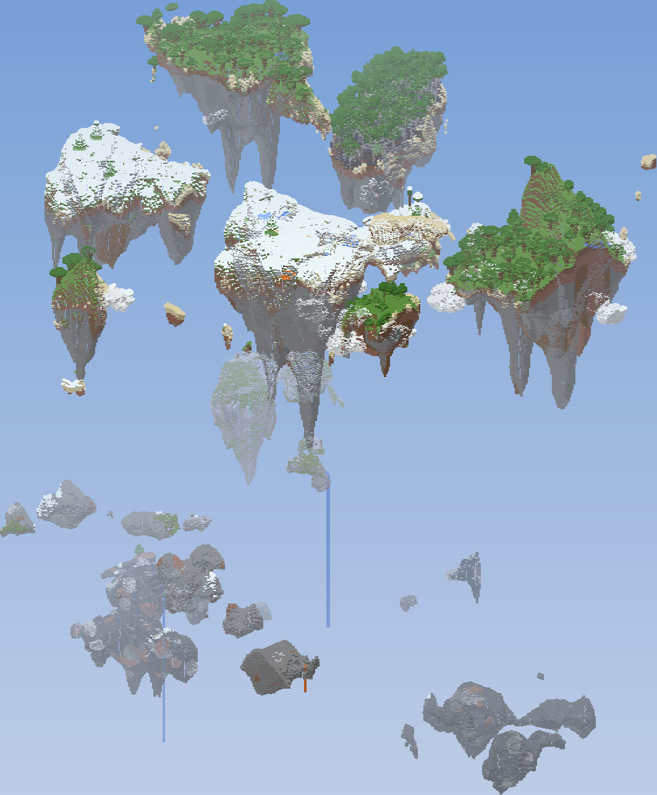
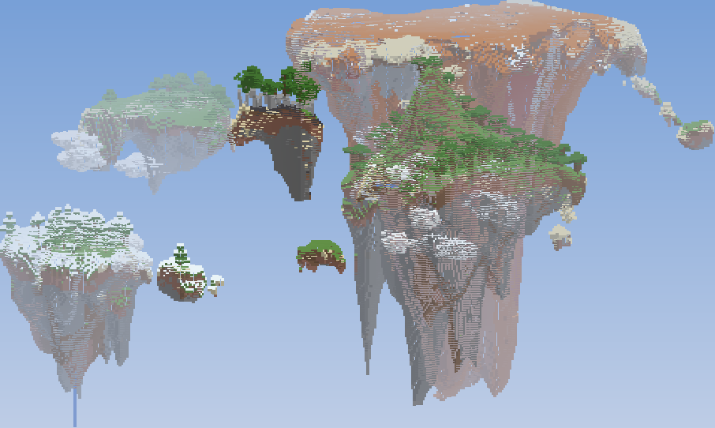
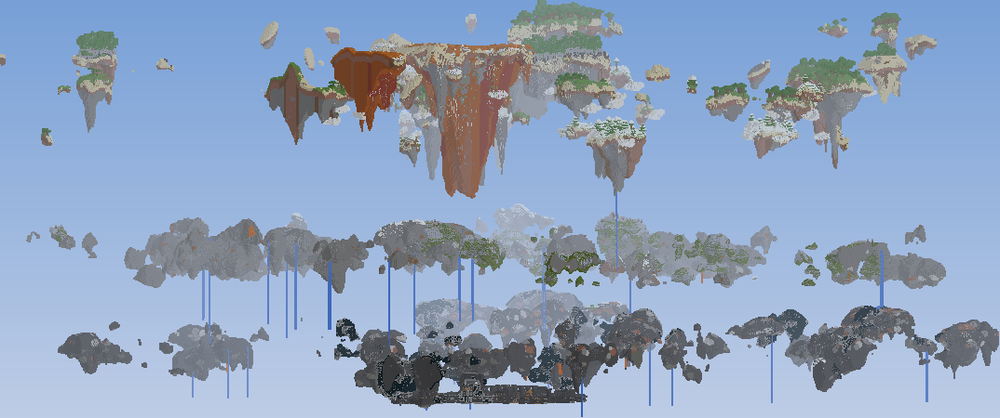

# Îles volantes — datapack Minecraft 1.21.1

Génération infinie d'îles flottantes sur trois niveaux, sans mod (datapack pur, vanilla 1.21.1).





## Installation

1. Prends `dist/Iles-Volantes-1.21.1.zip`.
2. Minecraft 1.21.1 → **Créer un nouveau monde** → **Plus** → **Packs de données** → glisse le zip dans la fenêtre et active-le.
3. Garde le type de monde **Par défaut** et crée le monde (accepte l'avertissement "paramètres expérimentaux").

Serveur : place le zip dans `world/datapacks/` **avant** la première génération du monde.

⚠️ Le pack modifie la génération : il ne marche que sur un **nouveau monde** (les chunks déjà générés ne changent pas).

## Ce que fait le pack

| Niveau | Hauteur | Contenu |
|---|---|---|
| Ciel | ~ y 150 → 440 | Îles au soleil : herbe, arbres, montagnes, villages, lacs, cascades, nuages blancs sur les flancs. Chaque île a son biome (forêt, plaine, désert, taïga, savane, badlands, neige, rivière, plage, mangrove…) |
| Pierre | ~ y 50 → 142 | Îles de pierre arrondies pleines de minerais ; biomes de caves (lush caves, dripstone caves) |
| Deepslate | ~ y -62 → 44 | Îles de deepslate arrondies avec les minerais profonds ; parfois du deep dark (sculk) |

- **Hauteurs différentes** : les masses de terre sont cassées le long de lignes de fracture sinueuses. Chaque morceau devient une île séparée, et passer une fracture change toujours la hauteur : deux îles voisines ne sont jamais au même niveau.
- **Tailles variées** : des grandes îles, des moyennes, des petites et des rochers flottants.
- **Îles anciennes** : bord du dessus effrité, encoches, cavités et corniches sur les parois, stries verticales, cône inversé avec stalactites et grosses masses rocheuses pendantes.
- Deux niveaux différents ne peuvent jamais se toucher (chacun a sa tranche de hauteur).
- Le monde fait 512 blocs de haut (-64 → 447). Le spawn est toujours sur une île du ciel.
- Les structures qui n'apparaîtraient que flottantes dans le vide sont désactivées : monuments, épaves, ruines océaniques, portails en ruine océaniques, mineshafts, trial chambers. Les strongholds restent (nécessaires pour l'End) : ils sont tout en bas.
- Le pack remplace les fichiers des biomes vanilla (pour ajouter nuages et lacs) : il peut ne pas être compatible avec d'autres packs qui modifient les biomes.

## Modifier la génération

Tout le pack est généré par `tools/build_pack.py`. Change les paramètres en haut du fichier puis lance :

```bash
python tools/build_pack.py
```

Paramètres principaux (dans `LEVELS`) :

- `threshold` : plus haut = moins d'îles, plus espacées.
- `small_islands` : quantité de petites et moyennes îles.
- `frac_width` : largeur du vide entre deux îles cassées par une fracture.
- `cell_amps` : écart de hauteur entre îles voisines.
- `base`, `height_var` : altitude moyenne du dessus des îles.
- `rim_pts` : forme du dessus (plat ou arrondi en dôme).
- `depth_pts`, `spike_pts`, `keel_pts` : profondeur du cône, stalactites, grosses masses pendantes.
- `erosion`, `ledges`, `streaks` : force de l'érosion des parois.
- `mountains` : hauteur des montagnes sur les îles du ciel.

Les nuages se règlent dans la section "Clouds" (`cloud_placed`), les lacs avec `lake_placed`, et les structures désactivées dans la boucle `has_structure`.

`tools/render.py` fait des images d'aperçu d'un monde déjà généré (`python tools/render.py <dossier_du_monde> <dossier_sortie>`, nécessite numpy et Pillow).
