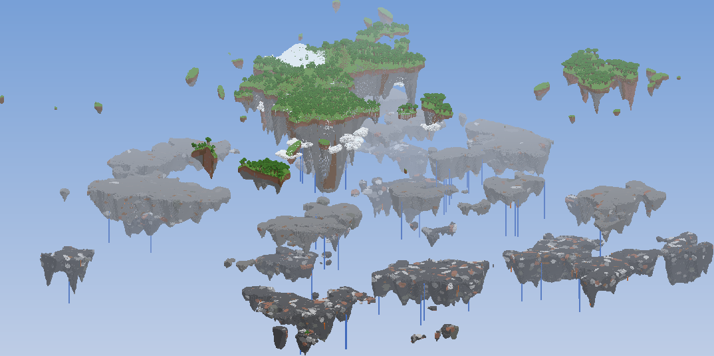
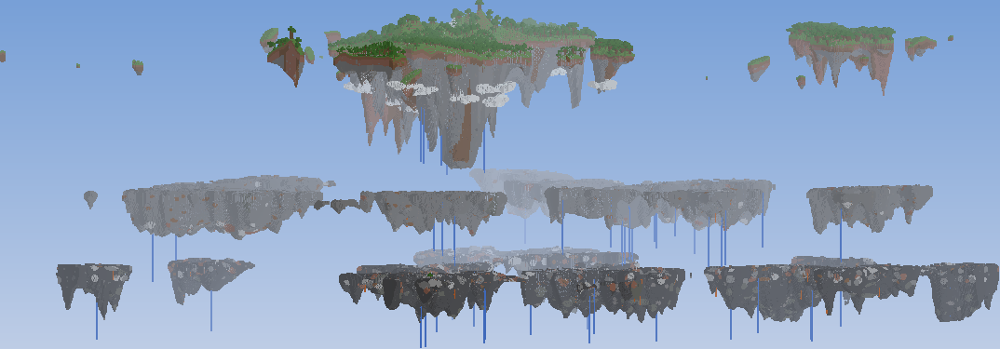

# Îles volantes — datapack Minecraft 1.21.1

Génération infinie d'îles flottantes sur trois niveaux, sans mod (datapack pur, vanilla 1.21.1).




## Installation

1. Prends `dist/Iles-Volantes-1.21.1.zip`.
2. Minecraft 1.21.1 → **Créer un nouveau monde** → **Plus** → **Packs de données** → glisse le zip dans la fenêtre et active-le.
3. Garde le type de monde **Par défaut** et crée le monde (accepte l'avertissement "paramètres expérimentaux").

Serveur : place le zip dans `world/datapacks/` **avant** la première génération du monde.

⚠️ Le pack modifie la génération : il ne marche que sur un **nouveau monde** (les chunks déjà générés ne changent pas).

## Ce que fait le pack

| Niveau | Hauteur | Contenu |
|---|---|---|
| Ciel | ~ y 120 → 380 | Grandes îles exposées au soleil : herbe, arbres, biomes, montagnes, villages, falaises brunes/grises, nuages blancs sur les flancs, cascades |
| Pierre | ~ y 34 → 110 | Îles de pierre (andésite, tuf) pleines de minerais, pas d'herbe |
| Deepslate | ~ y -62 → 26 | Îles de deepslate avec minerais profonds (diamant, redstone, or, lapis) |

- Chaque niveau vit dans sa propre tranche de hauteur : deux îles de niveaux différents **ne peuvent jamais se toucher**.
- Forme des îles : plateau sur le dessus, falaise sur le bord, puis un cône inversé avec des stalactites et de grosses masses rocheuses pendantes.
- Le monde fait 448 blocs de haut (-64 → 383).
- Le spawn est toujours choisi sur une île du ciel.
- Les structures qui n'apparaîtraient que flottantes dans le vide sont désactivées : monuments, épaves, ruines océaniques, portails en ruine océaniques, mineshafts, trial chambers. Les strongholds restent (nécessaires pour l'End) : ils sont tout en bas.

## Modifier la génération

Tout le pack est généré par `tools/build_pack.py`. Change les paramètres en haut du fichier puis lance :

```bash
python tools/build_pack.py
```

Paramètres principaux (dans `LEVELS`) :

- `threshold` : plus haut = îles plus petites et plus espacées.
- `mask_octave` : taille des îles (-8 = grandes, -7 = moyennes).
- `base`, `height_var` : altitude du dessus des îles et variation entre îles.
- `depth_pts` : profondeur du cône sous l'île selon la distance au bord.
- `spike_pts`, `keel_pts` : longueur des stalactites et des grosses masses pendantes.
- `mountains` : hauteur des montagnes sur les îles du ciel.

Les nuages se règlent dans la section "Clouds" (`cloud_placed`), et les structures désactivées dans la boucle `has_structure`.

`tools/render.py` fait des images d'aperçu d'un monde déjà généré (`python tools/render.py <dossier_du_monde> <dossier_sortie>`, nécessite numpy et Pillow).
